# ENG-V2-UX-01A: UI/UX audit and design concept

**Status: design proposal for owner review.** No application code, data, storage or deployment was changed.

| | |
|---|---|
| Date | 22 November 2026 (production audit run on 21 November 2026, 21:30–21:32 UTC) |
| Baseline | `main` at `f14dd4e33de2dfcbd8b80e1b72dbfec4326823d3` (ENG-V2-02B release) |
| Production checked | <https://shcherbak-pro.github.io/eng-trainer/>. All 21 published files match the ENG-V2-02B artifact inventory byte for byte, so the live audit covers this baseline. |
| Scope | v2 only. v1 was not opened for review and was not touched. |
| Evidence | [`eng-v2-ux-01a/`](eng-v2-ux-01a/): screenshots, measurements, accessibility snapshots, scripts and concept boards. See [Appendix B](#appendix-b-evidence-and-reproduction). |

## Summary

The v2 foundation is solid: transactional storage, careful import validation, three equivalent ways to answer flashcards, reduced-motion handling and readable text contrast in both themes. The interface around that foundation works against learning, especially on phones:

- **A one-tap action erases all progress.** The icon-only “Reset progress” button on Index clears what you marked as learned, your hidden items, Focus list, Learn Passes, flashcard rounds and preferences, with no confirmation and no undo (verified on production).
- **Phones show no study material on the first screen.** A 405 px banner and a two-row, 117 px bottom navigation push the first phrase to 1,117 px and the first learning block to 2,284 px on a 390 × 844 phone.
- **Almost every action is an unlabelled icon.** The Phrases page has 30 icon-only buttons whose meaning is only in a tooltip, which touch screens never show.
- **91 % of the first-load bytes are an icon font** (3.1 MB). While it loads, buttons show raw names such as `arrow_back` and `touch_app`, and the flashcard layout breaks.
- **Structural accessibility gaps:** no skip link, the page `<h1>` sits outside `<main>`, there is no current-page state, Ukrainian text is not marked `lang="uk"`, the light-theme focus ring is 2.0–2.15:1, and three screens scroll sideways at 320 px.

Three visual directions are proposed. **Recommended: Concept B, “Spoken Line”**, a voice-first design built around the product's real goal of speaking in an assessment. English study text is set in a reading serif, Ukrainian and interface text in a sans, and a highlighter marks the word being spoken. A phased plan keeps the first implementation step (ENG-V2-UX-01B) safe. That step covers the design-system foundation, the new shell and navigation, the destructive-action safeguards, the F3–F6 fixes and the accessibility baseline, with no data or storage changes.

## Contents

1. [Existing UX audit](#1-existing-ux-audit)
2. [Prioritized usability problems](#2-prioritized-usability-problems)
3. [Visual concepts](#3-visual-concepts)
4. [Recommended concept and rationale](#4-recommended-concept-and-rationale)
5. [Proposed shared design system](#5-proposed-shared-design-system)
6. [Interaction and animation recommendations](#6-interaction-and-animation-recommendations)
7. [Mobile and accessibility improvements](#7-mobile-and-accessibility-improvements) (including F3–F6 and the theme flash)
8. [Phased implementation backlog](#8-phased-implementation-backlog)
9. [Risks and regression areas](#9-risks-and-regression-areas)
10. [Recommended scope for ENG-V2-UX-01B](#10-recommended-scope-for-eng-v2-ux-01b)

Appendices: [A. Web Interface Guidelines findings](#appendix-a-web-interface-guidelines-findings) · [B. Evidence and reproduction](#appendix-b-evidence-and-reproduction) · [C. Design tooling](#appendix-c-design-tooling)

---

## 1. Existing UX audit

### 1.0 Method

- **Source review** of every v2 screen and shared component (`src/app`, `src/features`, `src/shared`, `src/app.css`, `index.html`), checked against the pinned Vercel Web Interface Guidelines ([Appendix A](#appendix-a-web-interface-guidelines-findings)).
- **Production review** with headless Playwright in fresh, non-persistent contexts and synthetic data only. It covered three viewports (390 × 844 phone, 320 × 640 small phone, 1440 × 900 desktop), light and dark themes, all 11 screens, and journeys for phrases, Focus, hide, reset, flashcards, Word Index, CSV import, rename, removal and export. It also covered stale writes in two tabs, a blocked database upgrade, a missing content manifest and a slow icon font.
- **Measurements:** element positions, focus order, target sizes, horizontal overflow, accessibility-tree snapshots, transferred bytes, theme-flash timings (normal CPU and 4× slowdown), WCAG contrast of the current tokens, and real glyph coverage of candidate fonts.
- **Limits:** Chromium was used throughout, and Firefox for the F3 check. Not covered: Safari/WebKit, real phones, screen-reader sessions (structure was judged from accessibility-tree snapshots) and audible speech quality. Owner data and profiles were never used.

### 1.1 What works and must be kept

- **Data safety:** import preview before any write, duplicate acknowledgement, all-or-nothing imports, retained progress after a collection is removed, a visible “not saved” notice with **Try saving again**, and a start screen that offers to continue without saving.
- **Flashcards:** swipe, buttons and arrow keys all answer the same way; the card has a clear accessible name; deck mode uses `aria-pressed`; the answer animation is skipped under reduced motion; the round order and position survive reloads.
- **Listening practice** for any filtered set, with adjustable repeats.
- **Theming:** a complete dark theme, `color-scheme` set, `theme-color` updated, and a global `prefers-reduced-motion` rule.
- **Text contrast:** every measured text and background pair passes WCAG AA in both themes ([data](eng-v2-ux-01a/audit/data/contrast-current.txt)).

### 1.2 Shell, navigation and information architecture

- **Eleven peer destinations** (Index, Phrases, Words, Flashcards, Reverse, Verbs, Patterns, Answers, Practice, Focus, Collections). On a 1440 px desktop the top navigation wraps onto a second line. On phones, 8 text-only items fill a two-row bar 117 px tall, and **Patterns, Answers and Practice are missing from the phone navigation** entirely (`MOBILE_PAGES` in `src/app/navigation.ts`).
- **Navigation is built from buttons, not links,** so pages cannot be opened in a new tab or copied as links. There is no `aria-current`, and the active item looks the same as a hovered one.
- **A banner on every screen except Flashcards** (an all-caps eyebrow, the page name, the course goal and five stat tiles) is 405 px tall on a phone, 445 px at 320 px and 301 px on desktop. The tiles (566 phrases, 566 words, 339 verbs, focus, hidden) cannot be acted on and repeat on every page.
- **First study content on screen** (the fold is 844 px on the phone and 900 px on desktop):

| Screen | Phone 390 × 844 | Desktop 1440 × 900 |
|---|---:|---:|
| Index (first learning block) | 2,284 px | 1,505 px |
| Phrases (first phrase) | 1,117 px | 784 px |
| Words (list) | 1,474 px | 784 px |
| Verbs | 1,233 px | 875 px |
| Focus (empty state) | 883 px | 689 px |
| Collections | 1,057 px | 861 px |

<p>
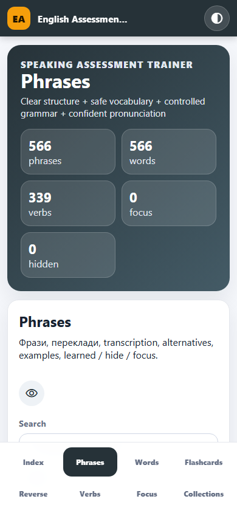
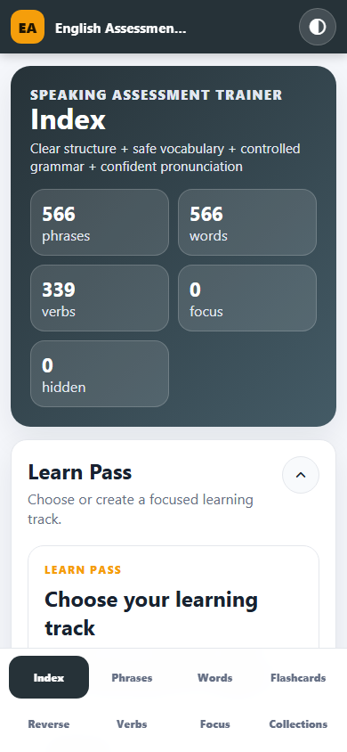
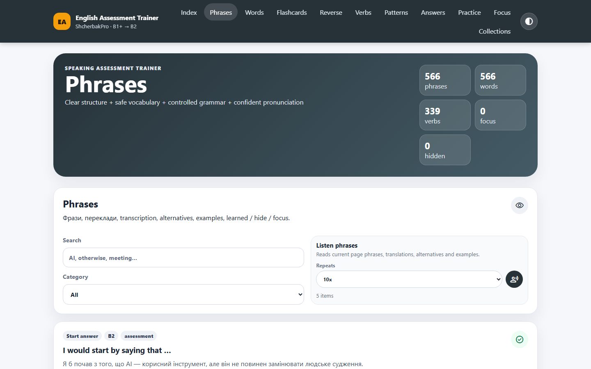
</p>

### 1.3 Visual hierarchy, typography, colour and spacing

- **No type scale.** `src/app.css` uses 25 different font sizes (15 between 0.74 rem and 1.35 rem) and only heavy weights (700, 800, 850, 900). With nothing at regular weight, emphasis stops working.
- **“Inter” is declared but never loaded,** so the app renders in Segoe UI, SF or Roboto depending on the device.
- **Everything is a rounded, shadowed card:** toolbars, panels, entries, notices, empty states and errors share one surface style, with nine different corner radii. Nothing tells the eye what is primary.
- **Colour roles collide.** Amber means Focus, “Keep learning”, the active segment, the focus ring and the banner eyebrow. Red “danger” styling is used for Hide, which can be undone, as well as for Reset.
- **Tokens describe components, not roles** (48 custom properties such as `--hero-stat-border` and `--topbar-hover`), and all styling is global (507 lines; one component has scoped styles). A redesign today means editing global selectors that tests also depend on.
- **Language mix:** the interface is English, but the Phrases, Words and Reverse introductions are Ukrainian sentences mixed with English (“Фрази, переклади, transcription, alternatives…”).

### 1.4 Vocabulary presentation and search

- **One phrase per phone screen.** A phrase card is 462 px tall, which is 70 % of the space left between the bars. Each card carries five icon-only actions (learned, speak, speak example, Focus, hide).
- **Inconsistent labels for the same idea:** “Meaning:” on words, “Translation:” on verbs and no label on phrases. “Learned” in Phrases versus “I know it” in Flashcards. “Focus”, “Focus List” and the internal “favorites”.
- **Small pages by default** (5 per page). Choosing “All” renders up to 566 cards and about 2,800 buttons with no virtualization.
- **Word Index on phones** is a 320 px list that scrolls inside the scrolling page (starting at 1,474 px), with the selected word's details below it, mostly off-screen. The selection is not in the address, so Back does not return to it.
- **Search** gives no visible or announced result count, has no clear button and is not a `type="search"` field.
- **Content observation:** 190 of the 343 phrase transcriptions mix IPA with ordinary spelling (for example `/good ˈtiːmwɜːrk starts with trʌst…/`). Any design that makes transcription more prominent will expose this.

### 1.5 Flashcards and practice

- **Rounds are the whole deck** (“Card 1 of 566”). There is no session size, no end-of-session moment and no summary, which is a lot for a 10-minute practice slot.
- **On a 1440 × 900 desktop the answer buttons end at 931 px,** below the fold, because the compact banner and toolbar push the card down. On phones the card and buttons fit, but the answer buttons end only 4 px above the bottom navigation.
- **Reset sits next to Review** in the toolbar as a red icon, the flip control is an ambiguous icon, and “Keep learning” reuses the Focus amber.
- **Reverse practice** hides its two main actions (Check, Show answer) behind icons. The check accepts any substring as “Looks close”, the result is not announced, and browser autocorrect and spellcheck can silently fix or hint at the answer.
- **Practice prompts** say “Click ‘Random prompt’ to start”, but no button carries that label, and the suggested 10-second/60-second flow has no timer.

<p>
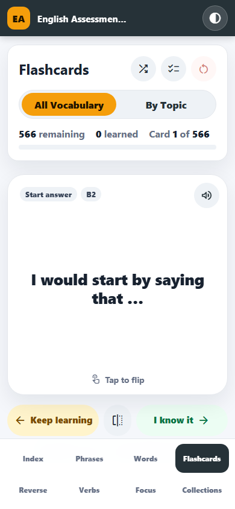
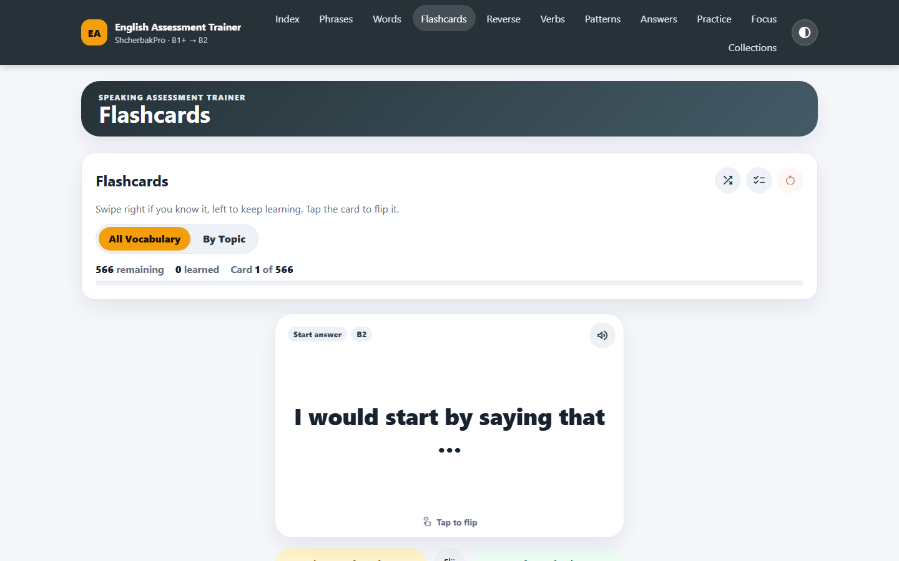
</p>

### 1.6 Focus list and learning progress

- The Focus list is an unbounded stack of full cards with no filters. It uses a star icon for blocks but plus and minus icons for entries.
- **Progress is fragmented.** Learned counts appear only inside Flashcards, focus and hidden counts only in the banner, and there is no place that shows what is due next.
- **Hiding is silent.** The entry disappears, nothing is announced and there is no undo. **Unhide all** (Phrases, Words, Verbs) clears every hidden item of that type immediately, with no confirmation or undo.

### 1.7 Collections: import, manage, export and reimport

- The page opens with three paragraphs of format rules above a bare native file input.
- **The preview is a five-column table.** On a phone it is 480 px wide inside a 328 px area, and words break mid-word (“ownershi p”, “відповіда льність”).
- **Success and error look identical:** both use the amber notice style.
- With no collections, the page says “**Try changing filters or search query.**” (the empty state's default text).
- **Messages appear at the top of the page,** far from the rename form or removal confirmation that triggered them.
- Button labels repeat the collection name (“Export Мої слова as JSON”), which makes phone buttons long.
- **Known findings F3–F6** reproduce in production; see [§7.4](#74-design-resolutions-for-f3f6-and-the-theme-flash).

<p>
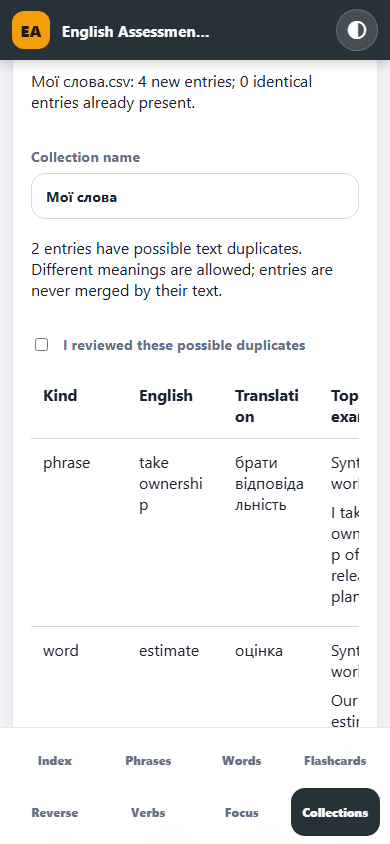
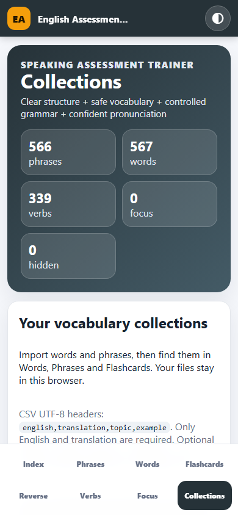
</p>

### 1.8 Feedback, errors, loading and empty states

- **Production screens show internal text.** The storage error shows `IndexedDB open failed: …`, and the content error shows `Failed to load /eng-trainer/data/manifest.json (HTTP 404)` followed by “For local development, run `npm run dev` or `npm run preview` after building.”
- **No undo anywhere,** no toasts, and two different confirmation styles (the native `window.confirm` dialog in Flashcards and Learn Passes, inline panels in Collections).
- Loading is a single “Loading training materials…” card, and empty states never offer an action.

<p>
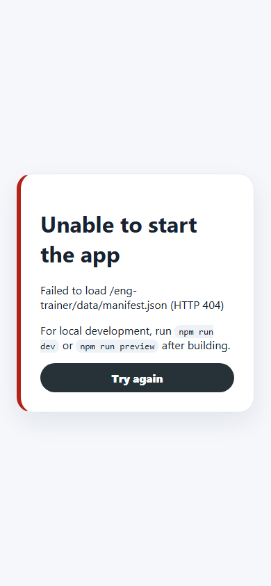
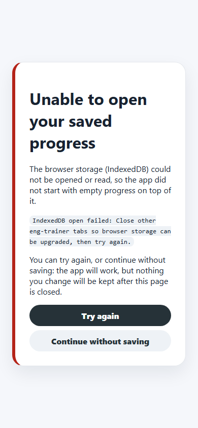
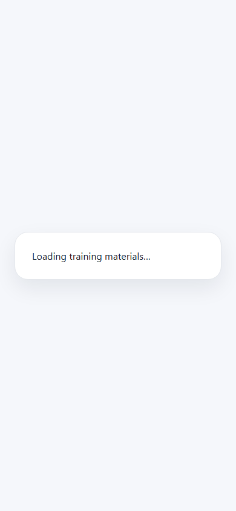
</p>

### 1.9 Accessibility (WCAG 2.2 AA)

| Criterion | Finding | Evidence |
|---|---|---|
| 1.3.1 Info and relationships | The page `<h1>` and the stat tiles sit outside `<main>`; every page repeats its name as `<h2>`; expansion panels put an `<h2>` inside a `<button>`; Focus list groups and their items are both `<h3>`; the stat tiles are bare text, not a list. | [aria snapshots](eng-v2-ux-01a/audit/data/aria/) |
| 2.4.1 Bypass blocks | No skip link. 19 Tab presses from page load to the first phrase's first control on desktop. | `production-audit.json` → `keyboard-desktop` |
| 2.4.11 Focus not obscured | Tabbing backwards, 4 of 40 focus stops land under the sticky header (desktop); tabbing forwards at phone width, 6 of 45 land under the fixed bottom navigation. No `scroll-padding`. | `keyboard-*` |
| 1.4.11 Non-text contrast | Light-theme focus ring (amber) is 2.15:1 on white and 2.00:1 on the page; input borders are 1.46:1 (light) and 2.17:1 (dark). The dark-theme ring passes (10:1). | [contrast](eng-v2-ux-01a/audit/data/contrast-current.txt) |
| 1.4.10 Reflow | Horizontal scrolling at 320 px: Phrases and Words (12 px), Verbs (72 px); the import preview scrolls sideways at 390 px. | `survey-small-light` |
| 3.1.2 Language of parts | Only `<html lang="en">`. Ukrainian translations and examples are read with English pronunciation rules. | `langAttributes` |
| 4.1.2 Name, role, value | Toggles (learned, Focus, hide, show hidden) change their label but expose no `aria-pressed`; the navigation has no current state; pagination puts an `aria-label` on a generic `div`. | source |
| 4.1.3 Status messages | Hide, Unhide all, Learn again, search results and the reverse-practice result are not announced. The whole listening control is a live region, so it re-announces repeatedly while speaking. | source |
| 2.5.8 Target size | Passes the 24 px minimum (icon buttons are 42 px), but 33 targets on Phrases and 61 on Index are below the 44 px touch guidance (topic chips are 26–38 px). | `targetsUnder44` |
| 3.3.x Errors | Import and rename errors are shown at the top of the page, away from the field or action that failed. | journey |
| Not a WCAG item, important here | No `translate="no"` on study content. If a browser offers to translate the page into Ukrainian, it also translates the English phrases being studied. | source |

<p>
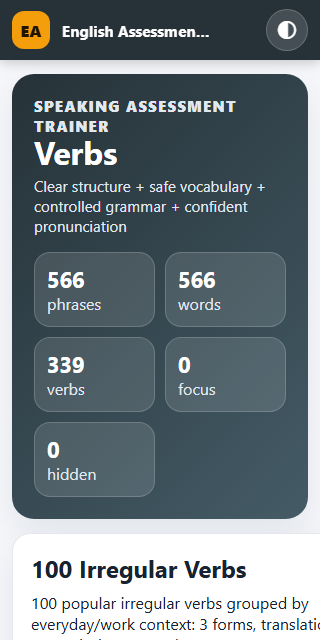
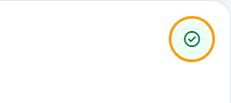
</p>

### 1.10 Motion and perceived performance

- **Motion** is limited to the card flip, the swipe exit, a hover lift on all buttons (which also sticks on touch screens) and a 200 ms colour transition on `body`. That transition turns the theme flash into a visible cross-fade ([§7.4](#74-design-resolutions-for-f3f6-and-the-theme-flash)). State changes such as hide, learned or import complete have no motion and no message.
- **Icon font.** The Material Symbols Rounded variable font weighs 3,132,808 bytes as WOFF2 in desktop Chrome, for about 30 icons. In the measured first load it was 91 % of the bytes transferred; the app's own JavaScript was 59 KB, CSS 8 KB, and the manifest plus all 11 content packs 241 KB. With `display=swap`, icon names render as text until the font arrives, which takes seconds on a slow phone connection.

<p>
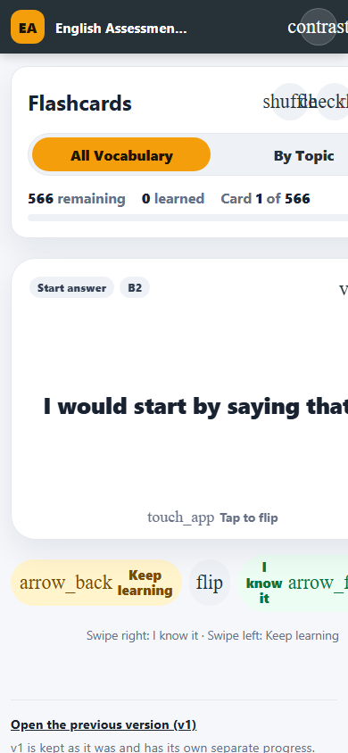
</p>

### 1.11 Component reuse today

Useful shared pieces exist: `IconButton` (36 uses), the three entry cards, `SpeakButton`, `SectionSpeechControl` (4 screens), `PaginationControls`, `EmptyState`, `CollectionFilter` and `ExpansionPanel`. However, their look comes from global class strings (`btn primary`, `card`, `notice`), and there is no Button, Field, Dialog, Toast or Notice component. That is why the same patterns drift: two confirmation styles, one notice style used for both success and failure, and five button variants used inconsistently. These shared pieces are the natural starting point for the design system (§5).

---

## 2. Prioritized usability problems

Severity: **Critical**: user data can be lost, or core learning is blocked. **High**: frequent friction, or a WCAG A/AA failure on a core journey. **Medium**: friction on a secondary journey, or a moderate accessibility gap. **Low**: polish.

| ID | Severity | Problem | Evidence | Design response |
|---|---|---|---|---|
| P1 | Critical | **Reset progress erases everything in one tap:** learned, hidden, Focus, Learn Passes, flashcard rounds and preferences, from an icon-only button on Index, with no confirmation and no undo. | `IndexPage.svelte:233` → `resetAllState()`. Production: Focus 2 → 0, hidden 1 → 0, no dialog. | Move to Settings, behind a confirmation dialog that lists what is cleared, with Cancel as the default (§5.3, [B7](#concept-b-spoken-line)). |
| P2 | High | No study content on the first phone screen (405 px banner, 117 px two-row navigation). | §1.2 table | Remove the banner; compact header; one-row navigation; content within the first 250 px. |
| P3 | High | 11 flat destinations: the desktop navigation wraps, the phone navigation takes two rows and omits 3 screens; buttons instead of links; no current state. | `navigation.ts`, `AppShell.svelte:41,100` | Five destinations (Home, Library, Practice, Focus, More) built from links with `aria-current`; hash IDs unchanged. |
| P4 | High | Unlabelled icon actions everywhere (30 on Phrases); Hide styled as danger; Focus shown as plus and minus. | §1.4 | Text labels on primary actions; a filled-star toggle for Focus; Hide moved to a secondary menu with Undo. |
| P5 | High | 3.1 MB icon font (91 % of bytes); raw icon names visible while it loads, breaking the layout. | §1.10 | Inline SVG icon set (about 25 icons, a few KB). |
| P6 | High | Structural accessibility: no skip link, `<h1>` outside `<main>`, duplicate headings, headings inside buttons, no `aria-current` or `aria-pressed`, no `lang="uk"`, no `translate="no"`. | §1.9 | Shell and component contracts (§5.6). |
| P7 | High | Focus visibility: amber ring 2.0–2.15:1; focus hidden under the sticky and fixed bars; input borders 1.46:1. | §1.9 | 2 px blue ring (5.4:1 or better); `scroll-padding`; 3:1 control borders. |
| P8 | High | Reflow failures at 320 px; import table overflows at 390 px. | §1.9 | Single-column filter bar; stacked import review. |
| P9 | High | Error copy: internal and developer text in production; F4 retry leaves a silent loader; F5 misleading; success looks like error. | §1.8, §7.4 | Error taxonomy and message patterns (§5.4); dedicated F4 waiting state. |
| P10 | Medium | Flashcard rounds are the whole deck (566); answer buttons below the fold on a 900 px desktop; Reset beside Review. | §1.5 | Session view with a size option (UI state only), answer bar in the thumb zone, Reset moved to a menu. |
| P11 | Medium | Low density: one phrase per phone screen; 5 per page; “All” renders up to 566 cards. | §1.4 | Rows instead of cards; `content-visibility` for long lists. |
| P12 | Medium | Word Index on phones: nested scroll list with details off-screen; selection lost on Back. | §1.4 | Single list with tap-to-detail (sheet or route); selected entry in the hash. |
| P13 | Medium | Silent bulk changes: Hide, Unhide all and Learn again have no confirmation, undo or announcement. | §1.6 | Toast with Undo; confirmation for Unhide all. |
| P14 | Medium | Import flow: dense rules, unstyled file input, preview table, F3 focus, errors far from the action, F6 filenames, wrong empty-state copy. | §1.7 | Import panel → review step → result; inline errors (§7.4). |
| P15 | Medium | Copy: mixed-language interface text; inconsistent terms; a reference to a label that doesn't exist. | §1.3–1.5 | Content guidelines (§5.5); one glossary. |
| P16 | Medium | Reverse practice: icon-only actions, lenient check, silent result, autocorrect interference. | §1.5 | Labelled Check and Show answer; announced result; `spellcheck`, `autocorrect` and `autocapitalize` off on the answer field; a difference view in Phase 3. |
| P17 | Low | Theme flash on slower devices: median 95 ms of light theme, then a 200 ms fade (4× CPU). None on fast devices. | §7.4 | Remove the boot-time transition; neutral loader. A storage-based fix needs an owner decision. |
| P18 | Low | 25 font sizes, heavy weights only, 9 radii, “Inter” never loaded, tokens named after components, global CSS. | §1.3 | Token layers and a type scale (§5.2). |
| P19 | Low | Hover lift on touch, no tap-highlight colour, no tabular figures, “1-5” with a hyphen, straight quotes in confirmations. | Appendix A | Base CSS (§5.2). |
| P20 | Low (content) | 190 of 343 phrase transcriptions are partial. | §1.4 | Content clean-up task; outside UI scope. |

---

## 3. Visual concepts

All three directions share the same safety, structure and accessibility fixes from §2, so the choice between them is about look, feel and emphasis, not quality. They also share one information architecture, which keeps every existing hash ID (`#index`, `#phrases`, `#wordIndex`, `#flashcards`, `#reverse`, `#irregularVerbs`, `#patterns`, `#answers`, `#practice`, `#favorites`, `#collections`), so links and the saved “last page” setting keep working:

| Destination | Contains | Phone | Desktop |
|---|---|---|---|
| **Home** | Resume flashcards, line of the day, learning blocks, Learn Pass switcher | tab | side or top navigation |
| **Library** | Phrases, Words, Verbs, Patterns, Answers (section tabs, shared search and filters) | tab | group with sub-items |
| **Practice** | Flashcards, Reverse practice, Speaking prompts | tab | group with sub-items |
| **Focus** | Focus list (grouped by type, with listen-all) | tab | item with count |
| **More** | Collections, Learn passes, Settings (theme, listening repeats, reset progress), previous version (v1) | tab opening a sheet | items in the side navigation |

Mockups are static HTML boards (not app code) built from real entries in `content/packs`. Counts and progress numbers in them are illustrative. Open the boards in a browser: [A](eng-v2-ux-01a/concepts/a-clear-desk.html) · [B](eng-v2-ux-01a/concepts/b-spoken-line.html) · [C](eng-v2-ux-01a/concepts/c-lexicon.html). Renders are in [`concepts/renders/`](eng-v2-ux-01a/concepts/renders/).

### Concept A: Clear Desk

*An evolution of the current look: same identity, much less noise.*

<p>
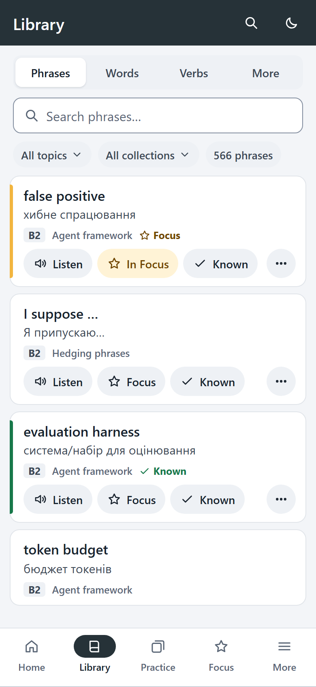
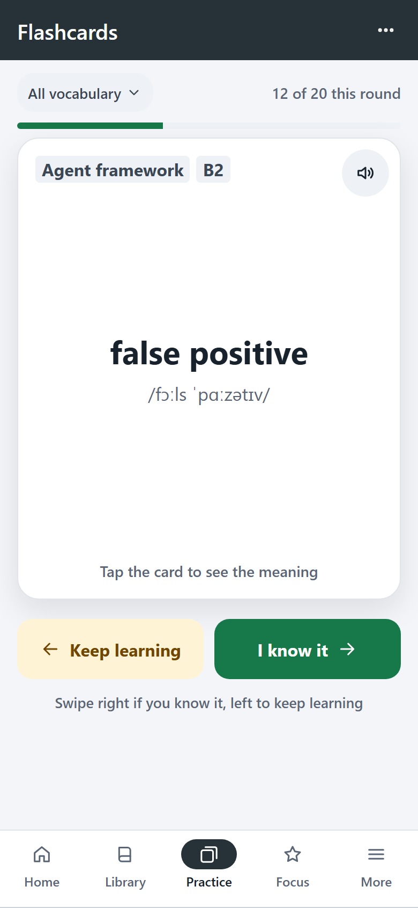
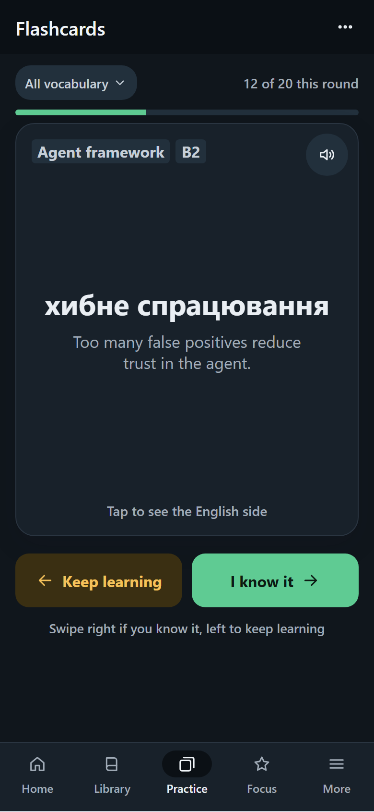
</p>
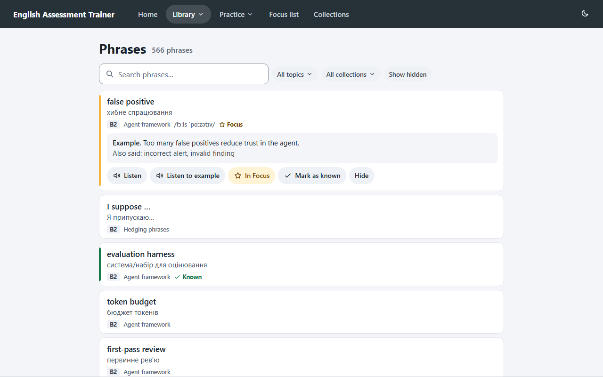

- **Principles:** content before chrome; one surface per job; every action says what it does; state is visible but quiet; familiar first, so current users do not relearn the app.
- **Colour and type:** keeps the slate app bar `#263238` and amber for Focus, adds a leaf green `#17784A` for Known and a blue focus ring `#1F4FC2`. Uses the platform interface font (Segoe UI, SF, Roboto): no download, and all three cover Cyrillic and IPA. Three weights only (400, 600, 700).
- **Layout and navigation:** a 56 px app bar holding the page title (`<h1>`); a five-item tab bar with icons and labels on phones; grouped top navigation on desktop; a centred 860 px content column.
- **Vocabulary and flashcards:** entries are compact cards with the English line, the Ukrainian line, metadata and labelled pill actions. A 4 px rule on the left marks Focus (amber) or Known (green), always paired with a text label. Flashcards keep today's card and flip, with labelled answers and a round counter (“12 of 20 this round”).
- **Interaction and motion:** today's flip and swipe, made calmer; Undo toasts; no new signature motion.
- **Phones:** first entry at about 220 px; four entries per screen.
- **Advantages:** lowest risk and cost; no new fonts; tests and the mental model change least.
- **Trade-offs:** still card-heavy; no distinctive identity; does little for listening and speaking beyond cleaning up; platform fonts render differently on each device.

### Concept B: Spoken Line

*Every entry is a line you will say. Hear it, say it, check it.*

<p>
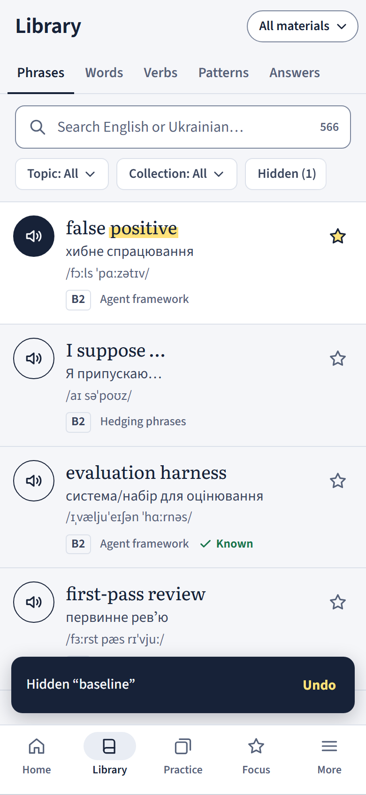
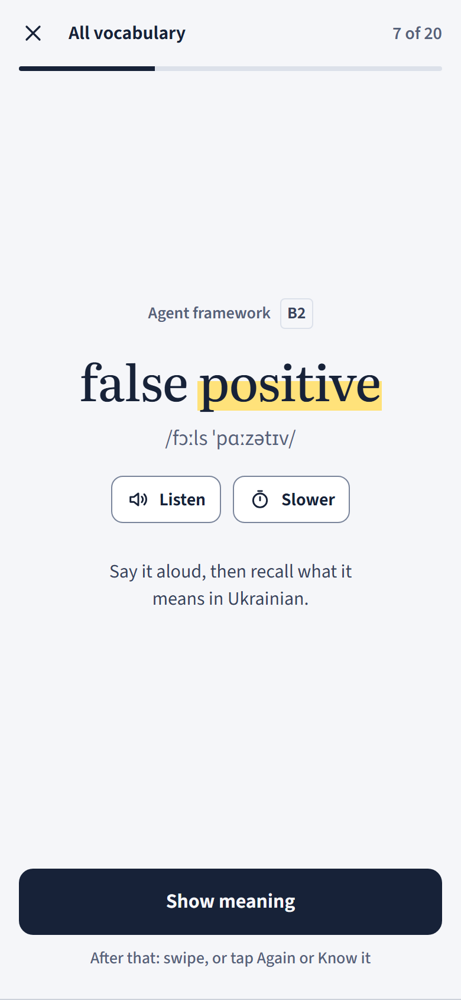
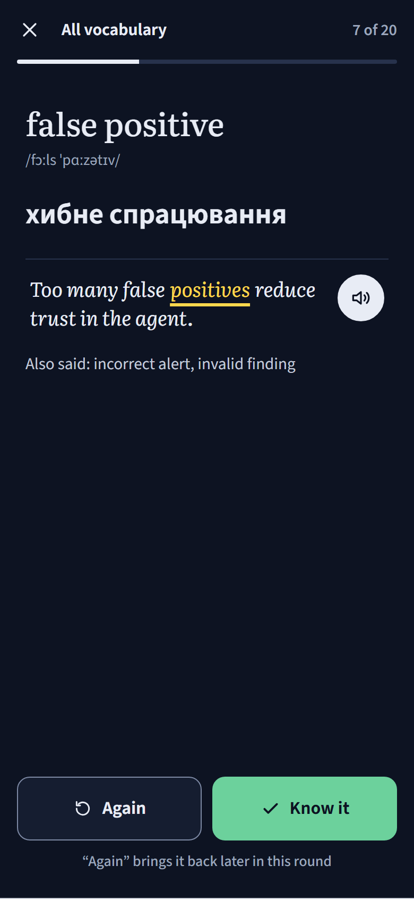
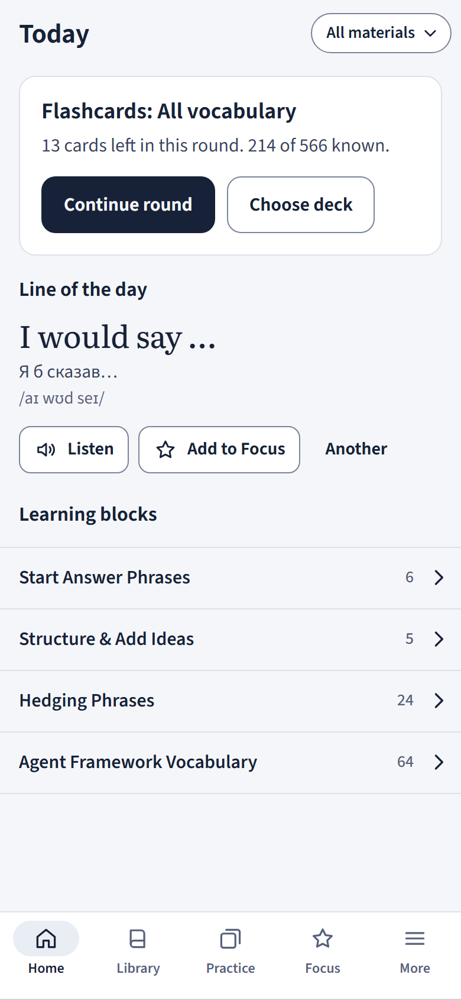
</p>
<p>
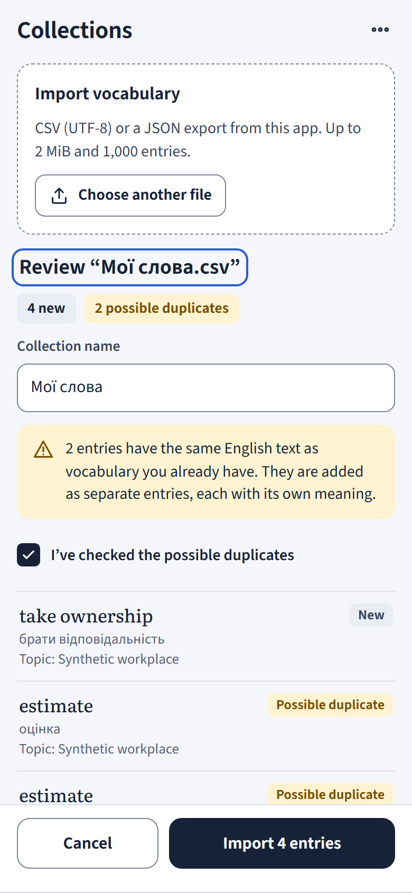
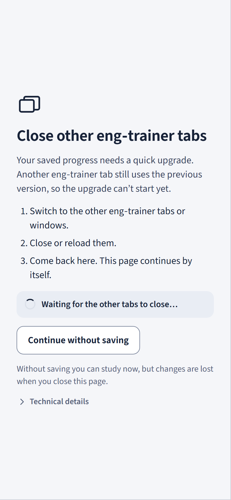
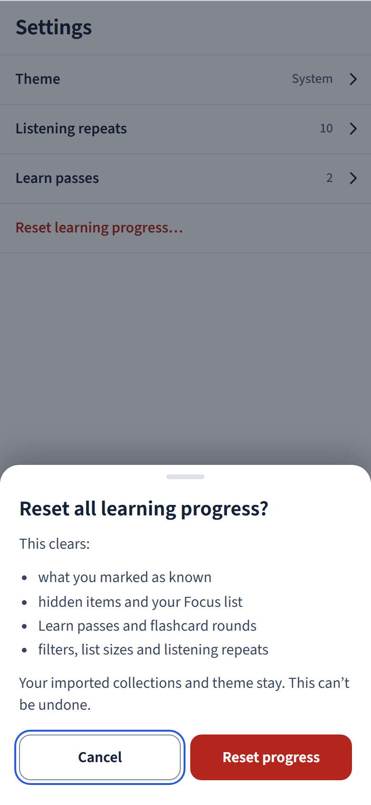
</p>
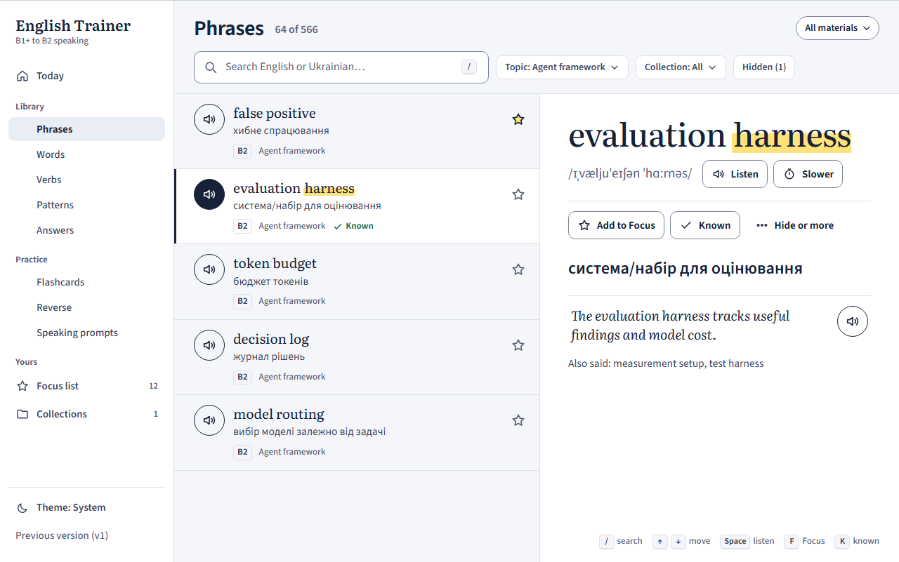

- **Principles:**
  1. English is the largest text on any screen that teaches.
  2. Listen, say, check is the loop on rows, cards and sessions.
  3. Language is encoded by typeface: English is always serif, Ukrainian is always sans, so target and translation never blur.
  4. One thing at a time while practising; dense rows while browsing.
  5. A highlighter, not confetti: feedback is quiet and specific, with no badges and no streaks.
- **Colour:** ink `#172238` (text and primary actions), cool paper `#F5F6F9`, white surfaces, highlighter yellow `#FFE27A` (the word being spoken and the Focus star), Known green `#17744A`, focus blue `#2C5BD6`. Dark theme: night `#0D1322`, ink `#E8ECF5`, highlighter `#FFD84D`. Every text and control pair is AA in both themes ([data](eng-v2-ux-01a/audit/data/contrast-concept-b.txt)).
- **Typography:** Literata (a variable reading serif with optical sizes, OFL) for English terms, phrases and examples; Source Sans 3 (OFL) for the interface, Ukrainian and IPA. Of ten families tested, only Source Sans 3 and Noto Sans render, from their web subsets, every symbol the content uses: 19 IPA and punctuation symbols across 1,832 transcription fields, plus і ї є ґ and ʼ. Literata lacks eight of the IPA symbols, so IPA is always set in Source Sans 3. Cost: about 190 KB WOFF2 for a typical first view, against 3.1 MB for today's icon font.
- **Layout and navigation:** phones get a compact header, a single tab bar, and Library section tabs with shared search and filter chips. Desktops get a side navigation grouped as Library, Practice and Yours, plus a two-pane Library: a list and a “reading stand” for the selected entry.
- **Vocabulary:** rows on paper (dividers, not cards). Each row has a 44 px round Listen button on the left; English (serif, 19 px), Ukrainian (sans), IPA and metadata in the middle; the Focus star on the right; hide and other actions in the entry view. About 4–5 entries fit on a phone screen; desktop shows the list and the selected entry side by side.
- **Flashcards:** a full-screen session without the tab bar. The front shows the term large, with IPA, Listen and Slower, and the prompt “Say it aloud, then recall what it means”. **Show meaning** reveals the answer in place, then **Again** and **Know it** answer in the thumb zone. Swipes and arrow keys still work exactly as today. Progress reads “7 of 20”, with a session-size option that lives only in UI state.
- **Signature interaction:** while speech plays, a highlighter stroke sits under the word being spoken (in the dark theme, an underline in highlighter colour). Pairing reading with listening is a well-established aid to connecting spelling and sound. Where the browser reports no word boundaries, the whole line is highlighted instead.
- **Phones:** first entry at about 215 px; answer buttons in the thumb zone; sheets for filters and More.
- **Advantages:** the design follows the product's purpose (speaking); clear bilingual hierarchy; distinctive but calm; the strongest improvement in mobile learning flow.
- **Trade-offs:** two web fonts to self-host and subset; the most new components; speech highlighting depends on browser support (progressive enhancement); the session view replaces today's card toolbar, so flashcard tests need updates.

### Concept C: Lexicon

*A learner's dictionary you can drill from.*

<p>
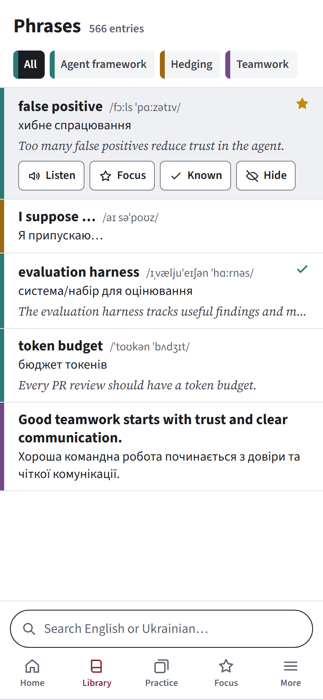
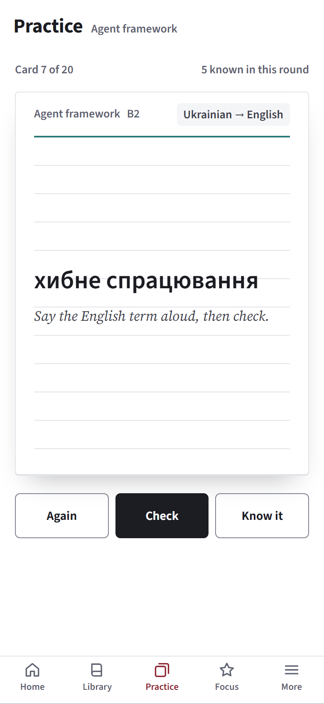
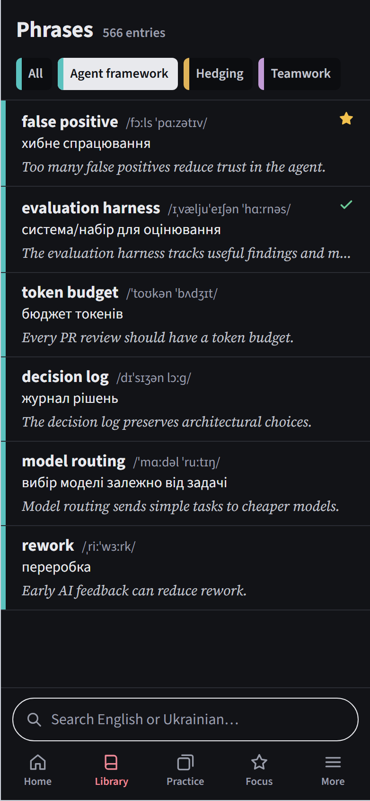
</p>
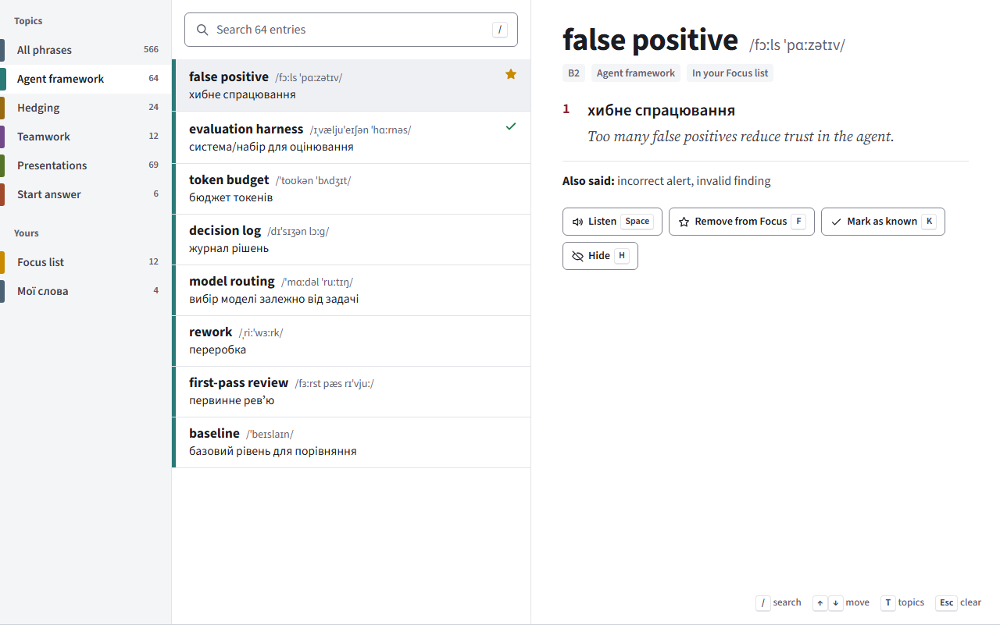

- **Principles:** reference-book clarity (headword, pronunciation, sense, example), the order learners know from dictionaries; density with rhythm; keyboard-first on desktop and thumb-first on phones; topics as a thumb index; status in plain words.
- **Colour and type:** white paper, ink `#1C1D22`, oxblood accent `#8A2432`, and six muted topic hues used only as thumb-index edges and always next to a text label. Source Sans 3 for headwords and the interface, with Source Serif 4 italic for examples (a matched superfamily).
- **Layout and navigation:** phones get a horizontal topic thumb strip and the **search field at the bottom, above the tab bar**, within thumb reach. Desktop uses three panes: topics, entries and the entry, with shortcuts (`/`, arrows, `Space`, `F`, `K`, `H`).
- **Vocabulary and flashcards:** dense dictionary rows (5–6 per phone screen) that expand in place; a ruled index card for practice, with a Ukrainian → English production drill.
- **Interaction and motion:** minimal: expand and collapse, keyboard focus movement, no signature motion.
- **Advantages:** best for scanning large libraries and 1,000-entry collections; strongest desktop productivity; makes the topic structure visible.
- **Trade-offs:** reference-first rather than practice-first; three panes and a keyboard model are the most complex to make accessible and to test; topic colours need care for colour-vision differences (they are always labelled); less distinctive on phones.

### At a glance

| | A: Clear Desk | B: Spoken Line | C: Lexicon |
|---|---|---|---|
| Learning focus | General | **Speaking and listening (product goal)** | Reference and recall |
| Phone flow | Good | **Best** (sessions, thumb zone) | Good (density, bottom search) |
| Desktop | Fair | Good (reading stand) | **Best** (three panes, keys) |
| Distinctiveness | Low | **High, calm** | Medium |
| Font cost | 0 KB | ~190 KB typical (≤353 KB all subsets) | ~225 KB typical (≤352 KB all subsets) |
| Implementation effort | **S–M** | M–L (phased) | M–L |
| Regression risk | **Lowest** | Medium (session view, shell) | Medium–high (keyboard model, panes) |

---

## 4. Recommended concept and rationale

**Recommendation: Concept B, “Spoken Line”, adopting two elements from C.**

1. **It serves the product's purpose.** The app exists to prepare people to *speak* in an assessment. B makes listening and saying aloud the primary action on every row and card, and turns flashcards into a short spoken-recall session: say it, then reveal, then rate. That is the retrieval practice the current deck already implies, without its 566-card rounds.
2. **It fixes the biggest measured problems directly:** content on the first phone screen (P2), five destinations (P3), labelled actions (P4), no icon font (P5), clear language hierarchy with `lang` and `translate` attributes (P6), answer controls in reach (P10) and density (P11).
3. **The typography is decided by evidence, not taste.** Source Sans 3 (like Noto Sans) renders all the content's IPA and Ukrainian characters from its web subsets; most families tested do not. It is preferred to Noto Sans for its more open, readable letterforms at small sizes. Literata gives the English line the weight a speaking line deserves.
4. **It stays inside the current architecture.** Svelte 5, CSS custom properties, native `<dialog>`, the existing stores, services and hash routes. No UI framework, no React, no new runtime dependency beyond self-hosted font files.
5. **The risk is containable.** The shell, tokens and components can ship first (UX-01B) without touching flashcard logic or storage. The session view and speech highlighting follow in later phases.

**Adopted from C:** the compact row variant for long lists and 1,000-entry collections (the “dense” density setting of `EntryRow`), and the keyboard shortcuts on desktop (`/` for search, arrows to move, `Space` to listen, `F` for Focus, `K` for known).

**Kept from A:** the migration discipline. Map existing values to tokens first, then change the look, and keep every hash ID and accessible name contract (§9).

If the owner prefers the lowest possible risk, A is a sound fallback: §5–§10 still apply, minus the fonts and the session view.

---

## 5. Proposed shared design system

### 5.1 Architecture

- **No UI framework.** The app is small, accessibility-sensitive and already well structured. Tailwind, Material or React would add weight and migration risk without solving a demonstrated problem. Use Svelte 5 components with scoped `<style>` blocks, CSS custom properties for tokens and native platform features (`<dialog>`, `:focus-visible`, `content-visibility`, the `popover` attribute where useful).
- **Files:**

  ```text
  src/styles/tokens.css    primitives and semantic roles, light and dark ([data-theme])
  src/styles/base.css      reset, typography defaults, focus ring, reduced motion, scroll padding
  src/shared/ui/           Button, IconButton, ToggleButton, Field, SearchField, Select, Checkbox,
                           FilePicker, Notice, Toast, ConfirmDialog, Sheet, SegmentedControl, Tabs,
                           FilterChip, EmptyState, LoadingState, ErrorState, Icon (inline SVG)
  src/shared/entries/      EntryRow, EntryDetail, LangText, ListenButton, ListenAll
  src/app/shell/           AppShell, SkipLink, AppBar, SideNav, TabBar, MoreSheet, PageHeader
  ```

- Keep the existing `data-theme` and `data-theme-preference` mechanism and the settings store. Components read semantic tokens only, never raw colours.
- Keep the current component syntax (`export let`, `$:`) in UX-01B for consistency; migrating to runes is a separate task.

### 5.2 Design tokens (Concept B values)

**Colour roles**

| Token | Light | Dark | Use |
|---|---|---|---|
| `--color-page` | `#F5F6F9` | `#0D1322` | Page background, `theme-color` |
| `--color-surface` | `#FFFFFF` | `#151D30` | Bars, sheets, selected rows, inputs |
| `--color-surface-sunk` | `#E9EDF4` | `#1E2942` | Chips, active tab pill, counts |
| `--color-text` | `#172238` | `#E8ECF5` | Primary text, primary action |
| `--color-text-secondary` | `#38445C` | `#C3CADA` | Translations, body copy |
| `--color-text-muted` | `#56627A` | `#9CA6BC` | Metadata, IPA, hints (5.7:1 and 7.6:1) |
| `--color-divider` | `#DCE1EA` | `#27324C` | Decorative rules only |
| `--color-border-control` | `#7A859B` | `#7D89A4` | Inputs, secondary buttons (3.4:1 or better) |
| `--color-highlight` | `#FFE27A` | `#FFD84D` | Spoken word, Focus star fill |
| `--color-known` / `--color-on-known` | `#17744A` / `#FFFFFF` | `#6CD19C` / `#0D1322` | Known state, Know it |
| `--color-warning-text` / `-soft` | `#7A4F00` / `#FFF3D1` | `#F3C35B` / `#33290F` | Duplicates, cautions |
| `--color-danger` / `--color-on-danger` | `#B3261E` / `#FFFFFF` | `#FF8B82` / `#0D1322` | Destructive actions only |
| `--color-focus-ring` | `#2C5BD6` | `#8DB2FF` | Focus indicator (5.4:1 and 7.9:1 or better) |
| `--color-inverse` / `--color-on-inverse` | `#172238` / `#F5F6F9` | `#E8ECF5` / `#0D1322` | Toasts |

**Typography**

| Token | Font | Size / line height | Use |
|---|---|---|---|
| `--text-display` | Source Sans 3, 650 | 28–30 / 1.15 | Page `<h1>` |
| `--text-title` | Source Sans 3, 650 | 20 / 1.3 | Section headings, dialog titles |
| `--text-body` | Source Sans 3, 400 | 16 / 1.5 | Interface and body text |
| `--text-small` | Source Sans 3, 500 | 14 / 1.4 | Metadata, hints, IPA |
| `--text-caption` | Source Sans 3, 600 | 12–13 / 1.3 | Tab labels, badges |
| `--line-list` | Literata, 430 | 19 / 1.32 | English line in rows |
| `--line-stage` | Literata, 470 | clamp(32px, 6vw, 46px) / 1.12 | Session term, reading stand |
| `--line-example` | Literata italic, 420 | 18–19 / 1.45 | Examples |

Rules: sentence case everywhere; no all-caps labels; tabular figures for counts and progress; `text-wrap: balance` on headings and `pretty` on lines; 70-character reading measure.

**Spacing, shape, elevation, layout**

- Spacing: 4, 8, 12, 16, 24, 32, 48, 64 px (`--space-1` to `--space-8`).
- Radius: 6 px (badges, chips), 10–12 px (controls, buttons), 14–20 px (cards, sheets); fully round only for Listen and icon buttons.
- Elevation: none for content (dividers instead); `--shadow-1` for bars and toasts; `--shadow-2` for sheets and dialogs.
- Breakpoints: below 600 px phone, 600–899 px large phone or tablet (still tab bar), 900 px and up side navigation; content up to 1,280 px.
- Targets: at least 44 × 44 px on touch; 32 px with 8 px spacing on fine pointers (never below 24 px).
- Z-index: app bar 20, tab bar 30, sheet 40, dialog 50, toast 60.

**Motion**

- Durations: `--dur-fast` 120 ms, `--dur-base` 200 ms, `--dur-slow` 320 ms.
- Easing: `--ease-standard` `cubic-bezier(.2,0,0,1)`, `--ease-exit` `cubic-bezier(.4,0,1,1)`.
- Under `prefers-reduced-motion`: opacity only, 120 ms or less, no translation or rotation.

**Fonts and icons**

- Self-host Literata and Source Sans 3 as WOFF2 with `unicode-range` subsets (Latin; Latin Extended, for IPA; Cyrillic; Greek, for θ).
- Preload only the Source Sans 3 Latin regular face, and use `font-display: swap` with metric-matched fallbacks.
- Replace Material Symbols with inline SVG icons (about 25, `aria-hidden`, `currentColor`).

### 5.3 Components, prioritized by current reuse

| # | Component | Replaces | Contract |
|---|---|---|---|
| 1 | **Button, IconButton, ToggleButton** | `IconButton` (36 uses), raw `.btn` (20) | Primary actions carry visible text. `IconButton` requires `label`. Toggles use `aria-pressed`. Variants: primary, secondary, quiet, known, danger. Loading state. Hover lift only under `@media (hover: hover)`. |
| 2 | **EntryRow, EntryDetail, LangText** | `PhraseCard`, `WordCard`, `IrregularVerbCard` (5 screens) | English in `LangText lang="en" translate="no"`, Ukrainian in `lang="uk"`. Listen, Focus and Known toggles call the **existing** progress APIs. Default and dense densities. Hide sits in the detail view or menu and offers Undo. |
| 3 | **ListenButton, ListenAll** | `SpeakButton` (14 uses), `SectionSpeechControl` (4 screens) | Playing state with `aria-pressed`. Only the status line is a live region. Rate control (Slower). Word highlight is progressive enhancement. |
| 4 | **Field, SearchField, Select, Checkbox, FilePicker** | Ad-hoc inputs on 8 or more screens | Visible label, hint and inline error (`aria-describedby`, `aria-invalid`). `type="search"` with a clear button and an announced result count. FilePicker never disables a focused control (F3). |
| 5 | **Notice, Toast, ConfirmDialog** | `.notice`, `.storage-notice`, `.error-card`, 2 × `window.confirm`, inline confirms | Notice tones are info, success, warning and error, distinct by icon and text, not colour alone. A Toast is `role="status"`, lasts 6 s, pauses on hover or focus and offers Undo. ConfirmDialog is a native `<dialog>`: focus starts on Cancel, Escape closes, focus returns to the trigger. |
| 6 | **AppShell, SkipLink, AppBar, SideNav, TabBar, MoreSheet, PageHeader** | `AppShell` banner, top bar, bottom navigation | One `<h1>` per view inside `<main>`; navigation from links with `aria-current="page"`; `scroll-padding` equal to the bar heights; safe-area insets. |
| 7 | **SegmentedControl, Tabs, FilterChip, Sheet** | Category selects, `CollectionFilter`, show-hidden toggles, deck mode | Filters in a chip row that scrolls with a fade on phones; a sheet for multi-field filters; the chosen filter shown as chip text. |
| 8 | **SessionHeader, Stage, AnswerBar, ProgressBar** | Flashcard toolbar and card layout | Restyle only: `flashcards.ts`, session order, cursor and persistence unchanged. |
| 9 | **EmptyState, LoadingState, ErrorState** | `EmptyState` plus ad-hoc screens | Every empty or error state names the next action; technical details go in a collapsed disclosure. |

### 5.4 Loading, empty and error states

| State | Pattern | Example copy |
|---|---|---|
| Starting | A quiet skeleton of the shell (bars and two row placeholders); no large white card; no colour transition until the theme is known. | (none) |
| Empty list | Title, one sentence, one action. | “No phrases match ‘estmate’.” [Clear search] |
| Empty Focus list | Explains how to add entries. | “Star a line in the Library to practise it here.” [Open Library] |
| No collections | States what to do and the formats accepted. | “Import a CSV or JSON file to add your own words.” [Choose file] |
| Validation error | Inline at the field, plus a summary at the top of the form that receives focus. | “Row 3: add a translation.” |
| Conflict (F5) | Notice next to the action, with a Reload button. | “This collection was changed in another tab. Reload to see the latest version, then try again.” |
| Storage full or failing | Banner with retry; explains the consequence. | “Couldn't save your changes. Your browser may be out of storage space.” [Try again] |
| Blocked upgrade (F4) | Dedicated waiting screen ([B6](#concept-b-spoken-line)). | “Close other eng-trainer tabs.” |
| Content failed to load | Plain cause and a retry; no developer instructions; technical details collapsed. | “The study material couldn't be loaded. Check your connection and try again.” |

### 5.5 Content guidelines

- The interface language is English (the learner's target and immersion language); Ukrainian appears only as translations and examples, always marked `lang="uk"`. The current Ukrainian introductions move into translated help text or are removed.
- One glossary: **Focus list** (not favourites); **Known** for the state and **Know it** for the answer (not Learned or I know it); **Hide** and **Show**; **Collection**; **Learn pass**; **Round** (a flashcard cycle) and **Session** (a sitting).
- Buttons are verbs that name the result: “Import 4 entries”, “Reset progress”, “Show meaning”.
- Errors say what happened, then what to do, with no apology and no internal terms (IndexedDB, HTTP, npm).
- Use typographic quotes and dashes, an en dash for ranges (“1–20”) and `Intl.NumberFormat` for counts.

### 5.6 Accessibility standard (definition of done)

WCAG 2.2 AA for every new or changed screen, including:

- A skip link; landmarks; one `<h1>` inside `<main>`; a heading order without gaps.
- `aria-current` on navigation, `aria-pressed` on toggles, live regions for status changes only.
- A 2 px focus ring with 2–3 px offset, at least 3:1 against both neighbours, never obscured.
- At least 3:1 for control borders, 4.5:1 for text.
- No two-dimensional scrolling at 320 px; text zoomable to 200 %.
- Touch targets of 44 px or more; every gesture has a button and a key alternative.
- `lang` on bilingual content; `translate="no"` on study text.
- Reduced-motion behaviour for every animation.
- Checks: role- and name-based unit tests, an automated axe pass in browser tests, and a keyboard-only and screen-reader smoke test (NVDA with Firefox, and VoiceOver on iOS when a device is available).

---

## 6. Interaction and animation recommendations

Motion should explain a change the person caused. Concept B has **one signature motion**, the highlighter under the word being spoken; everything else is functional and short.

| Interaction | Behaviour | Reduced motion |
|---|---|---|
| Answer a card (Again / Know it, swipe, ← →) | The card leaves towards the choice (180 ms), the next fades in (200 ms); the counter updates; a live region announces “Known: false positive. 13 left”. | Cross-fade, 120 ms |
| Show meaning | The meaning block fades in and moves up 8 px; replaces the 3D flip, which complicates reading order and reflow. | Opacity only |
| Speech | `SpeechSynthesisUtterance` boundary events move the highlighter word by word; without boundary support, the whole line is highlighted while speaking. Listen buttons show a playing state; one active playback at a time (as now). | Instant highlight, no sweep |
| Hide an entry | The row collapses (200 ms); toast “Hidden ‘baseline’” with Undo; focus moves to the next row. | Instant collapse |
| Toggle Focus or Known | The icon fills (120 ms); `aria-pressed` updates; no toast. | Instant |
| Unhide all, Reset progress, Remove collection | ConfirmDialog (or sheet on phones) that names exactly what changes. | Fade |
| Filters and More | Bottom sheet slides up (240 ms) with the scrim fading; desktop popover. | Fade |
| Import | Choose file → “Reading file…” on the button → focus moves to “Review ‘file.csv’” → Import → toast plus a result line in the collection list. | Same, no transitions |
| Navigation | Instant (no page transitions); each tab keeps its scroll position. | Same |
| Loading | Shell skeleton immediately; content swaps in without animation. | Same |

Responsiveness rules:

- Feedback appears within 100 ms of input, and saving stays optimistic (the existing queue); a message appears only when saving fails.
- Search filters on each keystroke (the catalogue is small) and announces the count after a 300 ms pause.
- Animate only `transform` and `opacity`; never `transition: all`; the progress bar uses `transform: scaleX`.
- Long lists use `content-visibility: auto` with an intrinsic size.

---

## 7. Mobile and accessibility improvements

### 7.1 Mobile

1. A one-row tab bar with five destinations (icon and label, 72 px including the safe area), replacing the 117 px two-row text bar.
2. No banner; a 56 px app bar with the page `<h1>`. Measurable goal: **first study content within the first 250 px** of Library, Focus and Collections on 390 × 844, and the flashcard answer bar fully visible without scrolling on 390 × 844 and 1440 × 900.
3. Rows instead of tall cards: 4–5 entries per phone screen by default, 6–7 in the dense variant.
4. Word Index becomes a list with tap-to-detail (a sheet on phones, the reading stand on desktop), with the selected entry in the hash (for example `#wordIndex/word-…`). No nested scroll areas.
5. Filters in a chip row plus a sheet; search sticks under the app bar.
6. Session answers in the thumb zone; swipe kept as a shortcut.
7. No horizontal scrolling at 320 px; the import review stacks entries (no table on phones).
8. Respect `env(safe-area-inset-*)` on all four sides; set the `-webkit-tap-highlight-color` deliberately; apply hover effects only on hover-capable devices.

### 7.2 Accessibility

Everything in §5.6, applied first to the shell and the most-reused components: skip link, landmarks and headings, link-based navigation with `aria-current`, focus ring and `scroll-padding`, toggle semantics, `lang` and `translate` attributes, live-region discipline, and ConfirmDialog in place of `window.confirm`.

### 7.3 Learning effectiveness, within existing data

These need no new stored data:

- A session size (10, 20 or all) kept in UI state.
- “Say it aloud” prompts and a Slower option (speech rate).
- An end-of-session summary listing what was marked Known and what to repeat.
- Reverse practice: a labelled Check, an announced result, autocorrect off, and later a difference view between the answer typed and the expected one.
- A Speaking-prompts timer (10 s to think, 60 s to speak) with an accessible countdown.

Spaced repetition (scheduling items for later review) requires a data-model decision and is left for a later milestone (§8, Phase 4).

### 7.4 Design resolutions for F3–F6 and the theme flash

| Finding | Current behaviour (verified) | Design resolution | Changes |
|---|---|---|---|
| **F3:** focus after file selection | The file input is disabled while the file is read (`CollectionsPage.svelte:73`). Whether focus is lost depends on the engine and timing: our probe kept focus on the input in Chromium 157 and 159, but lost it to `<body>` in Firefox 159 for an invalid file; Fable's review saw it in Chromium (preview and error) and Firefox (preview). In every engine, neither the preview nor the error receives focus, and the preview is not announced. | FilePicker keeps its button enabled and sets `aria-busy="true"` on the import region while reading. Afterwards, focus moves to the “Review ‘file.csv’” heading (`tabindex="-1"`) or to the error summary, which names the fix and offers “Choose another file”. See [B5](#concept-b-spoken-line). | UI only |
| **F4:** blocked-upgrade retry | First attempt: a generic “Unable to open your saved progress” with `IndexedDB open failed: …`. **Try again** while still blocked shows “Loading training materials…” with no guidance (observed for 4 s). The app recovered by itself 106 ms after the other connection closed. | A dedicated waiting screen (B6): “Close other eng-trainer tabs”, three numbered steps, a live “Waiting for the other tabs to close…” status, **Continue without saving** with its consequence, technical details collapsed. Retrying keeps this screen instead of switching to the loader; recovery stays automatic. | App start-up state (remember that a blocked attempt is pending); no storage format change |
| **F5:** stale-write wording | A rename after another tab's change says: “Collection change was not saved. No partial import or deletion was kept. IndexedDB write failed: Saved data changed in another session. Reload and review the import again. Check available browser storage and try again.” | Classify errors as conflict, storage failure, validation or unavailable. A conflict shows a notice next to the rename or remove action: “This collection was changed in another tab. Reload to see the latest version, then try again.” [Reload]. Storage advice appears only for storage failures. | A typed error from `storage/database.ts` and `collections/service.ts`, plus copy; no data change |
| **F6:** Cyrillic export names | “Мої слова” exports as `-.json` (the name filter keeps only `[A-Za-z0-9_-]`, `CollectionsPage.svelte:58`). | Keep Unicode letters and digits (`\p{L}\p{N}`). Replace spaces and reserved characters (`\ / : * ? " < > |`, control characters) with “-”; collapse repeats; trim dots and spaces; prefix Windows device names (CON, PRN, AUX, NUL, COM1–9, LPT1–9) with “_”; limit to 80 characters; fall back to “vocabulary”; append the export date: `Мої-слова-2026-11-21.json`. Confirm with a toast naming the file. | UI only |
| **Theme flash** | The system theme is applied before the saved theme is read from IndexedDB. On a fast desktop the saved Dark theme is in place before first paint (0 ms in 6 of 6 runs). With a 4× CPU slowdown the light theme was visible first in 5 of 6 runs (median 95 ms, range 7–223 ms), followed by a 200 ms colour fade from `body { transition }`. | Recommended now, without any storage change: (1) apply colour transitions only after start-up (a `theme-ready` class), so a late switch is instant rather than a fade; (2) use a minimal, low-contrast start-up skeleton so a mismatch is barely noticeable. **Owner decision:** a non-authoritative theme hint in `localStorage` or a cookie would remove the flash completely, but it breaks the rule that “v2 does not use localStorage” and would change the shared-origin storage snapshot that the v1 isolation checks compare. Not recommended for UX-01B. | (1) and (2) are CSS and markup only; the hint is a storage policy change |


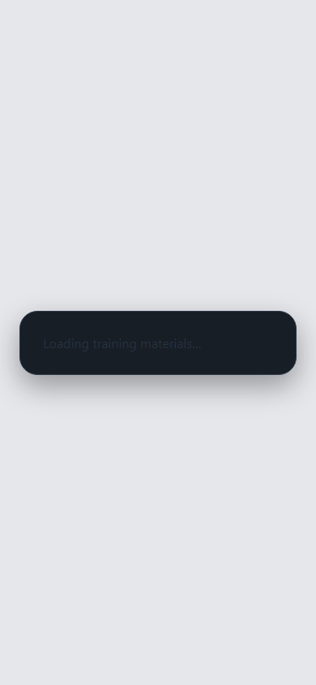 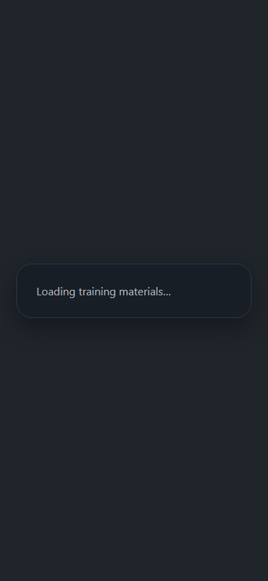

---

## 8. Phased implementation backlog

Sizes: S (under a day), M (1–3 days), L (3–5 days). No phase before 4 changes stored data or the IndexedDB schema.

**Phase 0: foundations, no visible change (start of UX-01B)**

| ID | Item | Acceptance |
|---|---|---|
| UX0-1 | Move tests from styling classes to roles and accessible names (`App.test.ts`, `FlashcardsPage.test.ts`, `retainedLearning.test.ts`) | The suite passes against today's UI with no class selectors except documented test IDs. M |
| UX0-2 | Add `tokens.css` and `base.css`, mapping today's values to semantic roles | Pixel-identical screenshots before and after. S |
| UX0-3 | Visual baseline: a Playwright screenshot set for 11 screens × 3 viewports × 2 themes, kept out of the deploy | Baseline committed with the UX-01B evidence. S |
| UX0-4 | Self-host the fonts (subsets, preload, fallback metrics) and replace the icon font with inline SVG | No Google Fonts requests; first load under 600 KB; no icon names visible on slow networks. M |

**Phase 1: shell, safety and components (rest of UX-01B)**

| ID | Item | Acceptance |
|---|---|---|
| UX1-1 | Button, IconButton and ToggleButton; Notice, Toast and ConfirmDialog; Field, SearchField, Select, Checkbox and FilePicker | Unit tests for roles and names, focus return and the reduced-motion path. M |
| UX1-2 | New shell: SkipLink, AppBar, TabBar (5), SideNav, MoreSheet, PageHeader; banner removed; links with `aria-current`; `scroll-padding` | Same hash IDs; v1 link kept; P2, P3 and P6 acceptance in §7. L |
| UX1-3 | **Safety:** Reset progress moves to Settings behind ConfirmDialog; Unhide all confirmed; Hide and Learn again get Undo toasts | P1 and P13 closed; the reset journey test asserts a dialog. M |
| UX1-4 | EntryRow, EntryDetail and LangText for Phrases, Words, Verbs, Focus and the daily item; `lang` and `translate`; Listen and Focus toggles | First content at or above 250 px; 44 px targets; no reflow at 320 px. L |
| UX1-5 | Collections import panel, stacked review, typed error notices; F3, F5 and F6 resolved | §7.4 acceptance; Cyrillic export name test. M |
| UX1-6 | F4 waiting screen; plain-language storage and content errors; theme-boot transition fix | §7.4 acceptance; no developer text in production. S–M |
| UX1-7 | Flashcards restyle within the existing logic: header, answer bar in reach, Reset moved to a menu | 1440 × 900 and 390 × 844 answer bar visible; flashcard tests green. M |

**Phase 2: learning flow (UX-01C)**

| ID | Item |
|---|---|
| UX2-1 | Flashcard session view (B2 and B3): session size, Show meaning, end-of-session summary |
| UX2-2 | Word Index tap-to-detail with the entry in the hash; desktop reading stand |
| UX2-3 | Home (“Today”): resume round, line of the day, learning blocks; Learn pass switcher; Learn pass management under More |
| UX2-4 | Filter chips and sheet; dense row variant; `content-visibility` for long lists |

**Phase 3: voice and practice (UX-01D)**

| ID | Item |
|---|---|
| UX3-1 | Word-by-word speech highlight (boundary events, fallback) and a Slower rate |
| UX3-2 | Reverse practice: labelled actions, announced result, difference view, autocorrect off |
| UX3-3 | Speaking prompts with an accessible think and speak timer |
| UX3-4 | Desktop keyboard shortcuts (`/`, arrows, `Space`, `F`, `K`, `H`) with a help sheet |

**Phase 4: needs data or storage decisions (separate milestones)**

| ID | Item |
|---|---|
| UX4-1 | Spaced repetition (due dates and intervals): new progress data and migration |
| UX4-2 | Theme hint outside IndexedDB to remove the flash entirely (storage policy) |
| UX4-3 | Per-collection progress purge (deferred ENG-V2-02B follow-up) |
| UX4-4 | Optional recording of your own pronunciation (microphone permission, privacy) |
| UX4-5 | Content clean-up of 190 partial transcriptions (content task) |

---

## 9. Risks and regression areas

| Area | Risk | Mitigation |
|---|---|---|
| Unit tests | Tests locate elements by layout classes (`.hero h1`, `.hero__stats`, `.storage-notice`, `.error-card`, `.flashcard__term`, `.flashcard-swipe`, `.phrase-card`, `.word-card`, `.theme-toggle`) and by names (“Mark as learned”, “Add to Focus List”, “Theme: …”, “I know it”, “Shuffle”). The redesign removes or renames these. | UX0-1 first; keep accessible names stable or change them deliberately with the tests in the same commit. |
| Production smoke scripts | The release evidence scripts in `docs/releases/*/` use the same selectors. | Update them for the next release verification; never rewrite past evidence. |
| Flashcard behaviour | Swipe thresholds, pointer capture, key handling, the answer animation timing (`EXIT_MS`) and retained deck order and cursor (ENG-V2-02B) are subtle. | Restyle around `flashcards.ts` without changing it; rerun the retained-learning and collections suites; manual swipe checks on touch emulation. |
| Hash routing and saved page | Renaming page IDs would break saved `activePage` values and links. | Keep all 11 IDs; add new IDs only for new views. |
| Settings | New stored preferences (session size, density) would change the settings data. | Keep them in UI state in UX-01B; propose stored settings later. |
| Reset semantics | Moving Reset must not change what it clears (learning state and preferences, theme kept, collections kept). | Same `resetAllState()`; dialog copy derived from it (B7); test the dialog and the result. |
| Fonts and build | New font files change the build output; `scripts/check-site.mjs` and the release inventory expect today's file set (21 files). | Update `check-site` and the release inventory deliberately; keep v1 assets untouched. |
| v1 isolation | v1 and v2 share an origin; v2 must not touch v1 `localStorage`. | No storage changes in UX-01B; keep the existing isolation checks in release verification. |
| Speech | Boundary events and voices vary (Firefox and some voices report no word boundaries). | Progressive enhancement; whole-line highlight fallback; manual check per engine. |
| Theme | Token changes can break dark theme parity or `theme-color`. | Contrast tests on tokens (scripted); screenshots in both themes. |
| Accessibility regressions | New dialogs, sheets and toasts can trap or lose focus. | Native `<dialog>`; focus-return tests; axe in browser tests; keyboard walkthrough. |
| Performance | Fonts add bytes; `content-visibility` can affect find-in-page and scroll anchoring. | Byte budget (first load under 600 KB); measure in Playwright; avoid `content-visibility` on the session view. |
| Scope creep | The redesign invites data-model work (spaced repetition). | Phase 4 is explicitly out of scope for UX-01B and UX-01C. |

---

## 10. Recommended scope for ENG-V2-UX-01B

**Goal:** ship the design-system foundation, the new shell and the safety and accessibility fixes in the chosen direction, with no change to data, storage, content or flashcard logic.

**In scope:** Phase 0 (UX0-1 to UX0-4) and Phase 1 (UX1-1 to UX1-7):

- Tokens and base styles in the chosen direction; self-hosted fonts (if B or C); inline SVG icons.
- Shell with five destinations, link-based navigation, skip link and no banner; the same hash IDs.
- Shared components (Button family, Field family, Notice, Toast, ConfirmDialog, EntryRow, ListenButton).
- Phrases, Words, Verbs, Focus and Collections rebuilt on those components.
- **Safety fixes for P1 and P13**, F3–F6, the F4 waiting screen, plain-language errors and the theme-boot transition fix.
- Flashcards restyled with the answer bar in reach; logic unchanged.

**Out of scope:** the session view and summary (UX2-1); Home redesign (UX2-3); speech highlighting (UX3-1); Reverse and Practice redesign (UX3-2, UX3-3); anything in Phase 4; any change to v1, content packs, the IndexedDB schema or stored records.

**Acceptance (summary):**

- First study content within 250 px of the top on 390 × 844 (Phrases, Words, Verbs, Focus, Collections).
- No horizontal scrolling at 320 px.
- Answer bar visible on 390 × 844 and 1440 × 900.
- Reset, Unhide all and collection removal confirmed; Hide undoable.
- F3–F6 behaviours from §7.4 verified in Chromium and Firefox.
- Every interactive element reachable and visible by keyboard, with focus never hidden; a skip link and a single `<h1>` in `<main>`.
- No Google Fonts requests and a first load under 600 KB.
- Existing behaviour tests pass (after UX0-1), plus new component tests; `npm run check`, `npm test`, `npm run build`, `npm run build:site` and the v1 checks pass.
- Before and after screenshots for 11 screens × 3 viewports × 2 themes; an axe run with no serious or critical issues; a keyboard walkthrough; production smoke for the changed journeys after release.

**Owner decisions needed before UX-01B starts:**

1. Choose a direction: A, B (recommended) or C, or a named hybrid.
2. Approve the five-destination structure (Home, Library, Practice, Focus, More) with unchanged hash IDs.
3. Approve self-hosted Literata and Source Sans 3 (B), or the system fonts (A).
4. Approve replacing the Material Symbols icon font with inline SVG icons.
5. Confirm the interface language policy (English interface, Ukrainian translations only).
6. Theme flash: accept the CSS-only mitigation now, and decide whether a theme hint outside IndexedDB is ever acceptable (Phase 4).
7. Confirm that Reset progress moves to More → Settings.

---

## Appendix A: Web Interface Guidelines findings

The Vercel Web Interface Guidelines (pinned, SHA-256 `d246b026…0234`) were checked against `src/app.css`, `src/app/*.svelte`, `src/features/**/*.svelte`, `src/shared/**/*.svelte` and `index.html`.

```text
index.html:10 - full Material Symbols variable font (3.1 MB) for ~30 icons; display=swap shows ligature names
index.html:13-28 - system theme applied before saved preference (theme flash; see §7.4)
src/app.css:2 - "Inter" declared but never loaded
src/app.css:106 - no scroll-padding for sticky header (68 px) and fixed bottom nav (117 px); focus obscured
src/app.css:112 - body color transition makes the late theme switch a visible fade
src/app.css:136,215,364,415,434 - focus ring amber #f59e0b: 2.15:1 on white, 2.00:1 on page (needs ≥3:1)
src/app.css:169 - input border #cfd6e4 1.46:1 on white (needs ≥3:1)
src/app.css:213 - hover lift not limited to (hover: hover); sticks on touch
src/app.css:238-240 - bottom nav: 8 text-only items in 2 rows
src/app.css:343 - pagination status without tabular-nums
src/app.css:422 - progress bar animates width → transform: scaleX
src/app/App.svelte:132 - raw error text in <code> shown to users
src/app/App.svelte:145 - developer instructions (npm run dev) in production error screen
src/app/AppShell.svelte:30 - brand navigates via <button> → <a>
src/app/AppShell.svelte:41,100 - navigation via <button>; no aria-current; no Cmd/Ctrl+click
src/app/AppShell.svelte:55-68 - <h1> and stats rendered outside <main> (main starts :70); no skip link
src/app/AppShell.svelte:62-66 - stat tiles are not a list; repeated on every page
src/features/home/ExpansionPanel.svelte:12-19 - <h2>/<h3> inside <button>; use heading > button
src/features/home/IndexPage.svelte:233 - destructive "Reset progress" without confirmation or undo
src/features/home/LearnPassManager.svelte:79 - window.confirm with straight quotes
src/features/home/LearnPassManager.svelte:160,164 - placeholders without "…"
src/features/home/LearnPassManager.svelte:191-192 - Save/Cancel as icon-only buttons
src/features/vocabulary/PhrasesPage.svelte:85 - "Unhide all" immediate, no confirmation or undo
src/features/vocabulary/PhrasesPage.svelte:95 - search input: no type=search, name, autocomplete=off
src/features/vocabulary/WordIndexPage.svelte:71,81 - same as Phrases (unhide all; search input)
src/features/vocabulary/WordIndexPage.svelte:99 - selected list item has no aria-current/aria-pressed; selection not in URL
src/features/vocabulary/IrregularVerbsPage.svelte:81,99 - same as Phrases (unhide all; search input)
src/features/flashcards/FlashcardsPage.svelte:188-189 - window.confirm with straight quotes
src/features/focus/FocusListPage.svelte:42-47 - group <h3> followed by item <h3>
src/features/focus/FocusListPage.svelte:51 - star icon here, add/remove icons elsewhere for the same action
src/features/exercises/ReversePracticePage.svelte:65 - answer textarea: add autocomplete/autocorrect/autocapitalize off, spellcheck=false
src/features/exercises/ReversePracticePage.svelte:76 - result not in a live region
src/features/exercises/PracticePage.svelte:23 - copy references a "Random prompt" label that does not exist
src/features/collections/CollectionsPage.svelte:58 - export name keeps only [A-Za-z0-9_-] (F6)
src/features/collections/CollectionsPage.svelte:73 - focused file input disabled while busy (F3)
src/features/collections/CollectionsPage.svelte:77-78 - error and success share one visual style
src/features/collections/CollectionsPage.svelte:126-128 - visible labels repeat the collection name
src/features/collections/CollectionsPage.svelte:145 - empty state shows "Try changing filters or search query."
src/collections/service.ts:103 - every write error gets import/storage wording (F5)
src/storage/database.ts:144 - conflict text mentions "the import" for rename/remove (F5)
src/shared/entries/HideButton.svelte:12-17 - reversible action styled as danger; no undo; not announced
src/shared/entries/PhraseCard.svelte:28,45 - study text lacks translate="no"; translation lacks lang="uk"
src/shared/entries/WordCard.svelte:18,25 - same
src/shared/entries/IrregularVerbCard.svelte:17,24 - same
src/shared/ui/IconButton.svelte:13-23 - toggles expose no aria-pressed
src/shared/ui/PaginationControls.svelte:28 - aria-label on a generic div
src/shared/ui/PaginationControls.svelte:40 - "1-5" → "1–5"
src/shared/speech/SectionSpeechControl.svelte:29 - whole control is a live region; limit to the status line
```

Passing areas: icon-only buttons have `aria-label`; decorative icons are `aria-hidden`; form controls have labels; there is no `transition: all` and no zoom blocking; the swipe gesture has button and key alternatives; dark theme sets `color-scheme`.

## Appendix B: Evidence and reproduction

Everything is in [`eng-v2-ux-01a/`](eng-v2-ux-01a/). All data is synthetic; no owner profile or learning data was accessed.

| Path | Content |
|---|---|
| `audit/screenshots/` | 18 curated production screenshots (phone, 320 px, desktop, dark, F4, F5, icon font, theme-flash frames) |
| `audit/data/production-audit.json` | Page survey (3 viewports × themes × 11 screens), journeys, F4/F5/F6, keyboard, icon font, page weight, provenance (21/21) |
| `audit/data/theme-flash-and-f3.json` | Theme timings (normal and 4× CPU) and F3 in Chromium 159 and Firefox 159 |
| `audit/data/icon-font-and-filmstrip.json` | Icon font flash and the size served to desktop Chrome (its theme fields are superseded; see the script header) |
| `audit/data/aria/` | Accessibility-tree snapshots of five screens |
| `audit/data/contrast-*.txt` | WCAG ratios for today's tokens and Concept B |
| `audit/data/glyph-coverage.txt` | Rendered glyph coverage for 10 candidate families (IPA, Ukrainian, punctuation) |
| `audit/scripts/` | Audit, probes, glyph coverage, contrast and concept rendering scripts |
| `concepts/*.html`, `concepts/renders/` | Three static concept boards and 16 renders |

To reproduce with an independently installed Playwright (1.65.x and matching browsers), run from the repository root. Pass the folder that contains `node_modules/playwright`:

```text
node docs/design/eng-v2-ux-01a/audit/scripts/production-audit.mjs <playwright-node_modules> docs/releases/eng-v2-02b-production/artifact-inventory.json <new-output-dir>
node docs/design/eng-v2-ux-01a/audit/scripts/theme-flash-and-f3.mjs <playwright-node_modules> <new-output-file.json>
node docs/design/eng-v2-ux-01a/audit/scripts/render-concepts.mjs <playwright-node_modules> docs/design/eng-v2-ux-01a/concepts/b-spoken-line.html <new-output-dir>
```

The scripts target the production URL. A later deployment changes the provenance comparison deliberately. The concept boards load Literata, Source Sans 3 and Source Serif 4 from Google Fonts for viewing only; the proposal is to self-host them.

## Appendix C: Design tooling

| Tool | Version and state | Use in this iteration |
|---|---|---|
| Claude Code (VS Code extension) | 2.1.329 | Host |
| Anthropic Frontend Design | `frontend-design@anthropic-plugin-directory` 1.1.1 (`73c8cf3`), enabled | Concept process: plan, check against common defaults, build, critique the renders |
| Vercel Web Design Guidelines | User skill, rules pinned to upstream `434b7f9`, SHA-256 verified | Code audit (Appendix A) |
| Playwright | MCP `@playwright/mcp` 0.0.84 (Playwright 1.65.0-alpha, Chromium 157), registered for the eng-trainer workspace only; this session started in the parent folder, so the MCP server was not loaded. The same pinned library was driven directly from Node in isolated headless contexts. The ENG-V2-02B release runner's Playwright 1.65.1 (Chromium 159, Firefox 159) was used for the F3 and theme timings. | Production audit, probes, concept rendering |
| Impeccable | 4.10.0 user skill, `user-invocable-only` | Not run: it is reserved for an explicit `/impeccable` command, its launcher downloads and runs a binary, and it writes `PRODUCT.md`, `DESIGN.md` and `.impeccable/` into the project. Suggested later use: `/impeccable critique` on the UX-01B branch. |
| UI/UX Pro Max | Installed (marketplace tag v2.15.0, manifest 2.13.0), **disabled** by the owner | Not enabled: enabling changes user-wide settings and adds 7 skills (including a slides skill that conflicts with the Marp workflow). Python 3.14 is now available through `py` if it is enabled later. |

No plugins, hooks or dependencies were added, and no tool configuration was changed.
